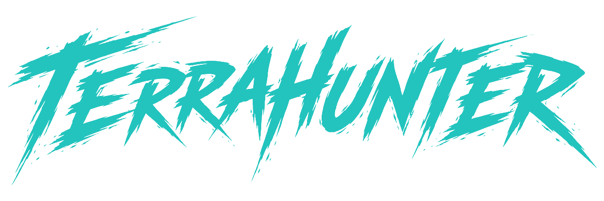

### Point it at your Terraform. See your infrastructure, and how an attacker would move through it.

> [!WARNING]
> **terrahunter is being rebuilt from the ground up.** This repository started again from scratch on
> 23 October 2026. It doesn't analyse anything yet; the pipeline below lands one stage at a time.

## The idea

Security scanners give you hundreds of findings, one resource at a time. What you actually want to know is the
question an attacker asks: **can the internet reach something, and where can it go from there?**

terrahunter answers that by drawing your infrastructure the way an architect would (accounts, VPCs, subnets,
services, the connections between them) and then walking you through each path an attacker could chain across it,
one hop at a time, with what's wrong at every step.

## How it will work

1. **Point it at a folder.** Any repository checkout. terrahunter finds the Terraform root modules in it, wherever
   they sit.
2. **It tells you what's missing first.** Modules that haven't been downloaded, remote state, other repositories the
   connections run through. You fetch them, point at them, or skip them, and anything skipped is shown as unknown
   rather than silently left out.
3. **It maps the connections and draws the diagram.** An architecture diagram in the style of a cloud design tool,
   flat 2D or 3D isometric, with plumbing such as security groups and policy attachments folded into what they
   affect ("open to the internet on 22", "long-lived access key").
4. **It hunts for vulnerabilities.** trivy and checkov findings are attached to the resource they're about.
5. **It maps the attack paths.** Internet → a resource at the edge → resources inside: could an attacker chain these
   weaknesses together?
6. **It shows you the results.** Pick a path and walk through it: everything else fades, and each step zooms in on
   one hop and explains what's wrong there and what to fix.

## Status

| Stage | |
|---|---|
| 1. Folder in | planned |
| 2. What's missing | planned |
| 3. Connections and diagram | planned |
| 4. Vulnerabilities | planned |
| 5. Attack paths | planned |
| 6. Results and walkthrough | planned |

## Security

terrahunter is meant to run on Terraform you don't necessarily trust, such as a pull request from a stranger.
See [SECURITY.md](SECURITY.md) for what that covers and how to report a problem privately.

## License

[MIT](LICENSE)
